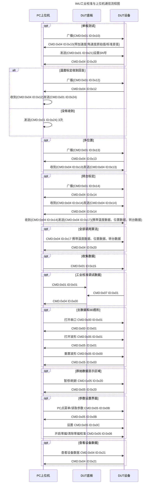

# IMU


# 1 IMU简介

​	IMU（Inertial Measurement Unit，惯性测量单元）是一种用于测量物体运动状态和姿态信息的传感器模块，通常由三轴加速度计、三轴陀螺仪以及磁力计组成，可实时获取设备的加速度、角速度和方向信息。通过姿态融合算法，IMU能够计算出设备的俯仰角、横滚角和航向角，广泛应用于无人机、机器人、汽车导航、手机、工业控制及智能设备等领域，是实现运动检测与姿态控制的重要核心器件。


# 2 IMU包含那些传感器

- 最基础的 IMU 通常包含：

  | 传感器   | 作用           |
  | -------- | -------------- |
  | 加速度计 | 测量线性加速度 |
  | 陀螺仪   | 测量角速度     |

- 高级 IMU 还会增加：

  | 传感器 | 作用         |
  | ------ | ------------ |
  | 磁力计 | 测量地磁方向 |
  | 气压计 | 测量高度     |


# 3 常见IMU分类

- 6轴IMU包含如下
  - 3轴加速度计
  - 3轴陀螺仪
  - 例如：MPU6050/ICM-20602
-  9轴IMU
  - 3轴加速度计
  - 3轴陀螺仪
  - 3轴磁力计
  - 例如：ICM-20948/MPU9250
- 工业级IMU特点
  - 高精度
  - 低漂移
  - 高稳定性
  - 例如：Analog Devices 的 ADIS 系列。


# 4 IMU测量什么

-  加速度计
  - 单位：`m/s²` 或 `g`
  - 测量内容：
    - 运动加速度
    - 重力方向
    - 倾斜角
- 陀螺仪
  - 单位：角速度 `°/s`或`rad/s`
  - 例如：绕X轴每秒旋转90°(GyroX = 90°/s)
- 磁力计
  - 测量内容：
    - 地磁场方向
  - 使用场景：
    - 航向角
    - 北方向


# 5 IMU坐标系

​	IMU坐标系一般分为如下几种：

```tex
X：左右
Y：前后
Z：上下
```

​	常见右手坐标系如下：


# 6 IMU核心问题

​	IMU最大问题，即积分漂移，例如陀螺仪角速度：
$$
θ=∫ωdt
$$
​	理论上积分得到角度，但是陀螺仪存在 **零偏**、**噪声**、**温漂** 导致角度越来越偏


# 7 为什么要融合

​	需要融合的原因如下：

| 传感器   | 优点     | 缺点     |
| -------- | -------- | -------- |
| 加速度计 | 长期稳定 | 抖动大   |
| 陀螺仪   | 短期平滑 | 长期漂移 |
| 磁力计   | 提供航向 | 易受干扰 |

​	所以需要进行传感器融合，常见算法问题如下：

| 算法                 | 特点       |
| -------------------- | ---------- |
| Complementary Filter | 简单       |
| Kalman Filter        | 精度高     |
| Mahony               | 常用       |
| Madgwick             | 无人机常用 |


# 8 IMU输出的数据

​	IMU输出的典型数据如下：

```c
typedef struct
{
    float Acc[3];
    float Gyro[3];
    float Mag[3];

    float Pitch;
    float Roll;
    float Yaw;
} IMUData_S;
```


IMU校准




