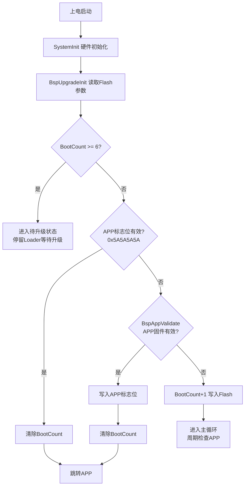
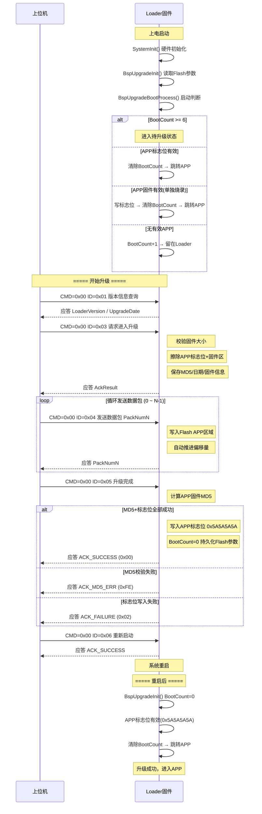

# 志翔`Loader`固件升级协议&指令说明文档

[TOC]


------

# 1 文档概述

​	本文档主要描述志翔`Loader`固件的升级通信协议与启动流程，用于上位机软件与`Loader`固件进行交互，完成`APP`固件的烧录与升级。

​	`Loader`固件负责：

1. **启动判断**：检查`APP`有效性，有效则跳转执行`APP`；连续启动失败达到阈值后进入待升级状态；

2. **固件升级**：接收上位机发送的`APP`固件数据，校验完整性后写入`Flash`，并跳转执行`APP`；


# 2 AT指令

​	志翔`Loader`支持的`AT`集如下：

| 指令                 | 功能                 | 应答                                                         | 描述                                                         |
| -------------------- | -------------------- | ------------------------------------------------------------ | ------------------------------------------------------------ |
| `AT+VERSION?\r\n`    | 版本查询             | `LoaderVersion:V1.0.0.1`<br/>`UpgradeDate:2026-08-13`<br/>`OK` | 示例指令：`Loader`版本查询<br />`Loader`版本号：`V1.0.0.1`<br />升级日期：`2026-08-13` |
| `AT+FLASHINFO?\r\n`  | `Flash`升级信息查询  | `=== Flash Upgrade Info ===`<br/>`LoaderVersion:V1.0.0.1`<br/>`UpgradeDate:2026-08-13`<br/>`MD5:A8E49A18586BD70E4E7B19B2FFC3F059`<br/>`AppExist:Yes`<br/>`==========================`<br/>`OK` | 示例指令：`Flash`升级信息查询<br />`Loader`版本号：`V1.0.0.1`<br />升级日期：`2026-08-13`<br />`MD5`校验值：`A8E49A18586BD70E4E7B19B2FFC3F059`<br />`APP`存在状态：`Yes` |

> [!IMPORTANT]
>
> 1. `AT`指令必须是**大写**，且须以回车换行符结尾(`CRLF`)。
> 2. 串口默认波特率为`921600`，`8 bit`数据位，`1`位停止位，无校验。
> 3. 所有的`AT`指令均有应答`OK`回复。


# 3 Flash地址布局

## 3.1 GD32F103平台（BSP_103_MCU，1KB页）

| 起始地址      | 结束地址      | 大小   | 用途                              |
| ------------- | ------------- | ------ | --------------------------------- |
| `0x08000000`  | `0x08004FFF`  | `20KB` | `Loader`固件区                    |
| `0x08005000`  | `0x080053FF`  | `1KB`  | `Loader`参数区（`FlashInf_S`）    |
| `0x08005400`  | `0x080057FF`  | `1KB`  | `APP`存在标志位（值=`0x5A5A5A5A`） |
| `0x08005800`  | `0x08005FFF`  | `2KB`  | `APP`参数区（产品信息等）         |
| `0x08006000`  | `0x0801FFFF`  | `104KB`| `APP`固件区                       |

## 3.2 GD32F303平台（BSP_303_MCU，2KB页）

| 起始地址      | 结束地址      | 大小   | 用途                              |
| ------------- | ------------- | ------ | --------------------------------- |
| `0x08000000`  | `0x08003FFF`  | `16KB` | `Loader`固件区                    |
| `0x08004000`  | `0x080047FF`  | `2KB`  | `Loader`参数区（`FlashInf_S`）    |
| `0x08004800`  | `0x08004FFF`  | `2KB`  | `APP`存在标志位（值=`0x5A5A5A5A`） |
| `0x08005000`  | `0x08005FFF`  | `4KB`  | `APP`参数区（产品信息等）         |
| `0x08006000`  | `0x0801FFFF`  | `104KB`| `APP`固件区                       |

## 3.3 用户参数区结构（FlashInf_S）

​	用户参数区存储`Loader`的持久化信息，结构体定义如下：

```c
/* Flash持久化信息 */
typedef __packed struct
{
    unsigned int LoaderVersion;    /* Loader版本号 */
    unsigned int UpgradeDate;      /* 升级日期（年.月.日打包） */
    unsigned char MD5[16];         /* MD5校验值 */
    unsigned char AppToLoaderFlag; /* APP请求Loader升级标志 */
    unsigned int BootCount;        /* 连续启动失败计数（达到阈值进入待升级） */
} FlashInf_S, *pFlashInf_S;
```

| 字段             | 偏移(字节) | 长度(字节) | 类型     | 描述                                              |
| ---------------- | :--------: | :--------: | :------- | ------------------------------------------------- |
| `LoaderVersion`  |     0      |     4      | `u32`    | `Loader`版本号（大端：主.次.修订.构建）           |
| `UpgradeDate`    |     4      |     4      | `u32`    | 升级日期（年.月.日打包）                          |
| `MD5`            |     8      |     16     | `u8[16]` | 最近升级固件的`MD5`校验值                         |
| `AppToLoaderFlag`|     24     |     1      | `u8`     | `APP`请求`Loader`升级标志                         |
| `BootCount`      |     25     |     4      | `u32`    | 连续启动失败计数（达到`6`进入待升级）             |
|                  |            |            |          |                                                   |

> [!NOTE]
>
> `BootCount`阈值通过 `HAL_BOOT_COUNT_MAX` 宏配置，默认为 `6`。


# 4 协议介绍

​	志翔`Loader`升级协议用于上位机和`Loader`固件之间进行通信，该协议具备以下特性：

1. 紧凑：使用`8bit`二进制数据；

2. 数据校验：使用低开销的校验算法；

3. 统一：所有多字节数据都是**小端模式**，包括数据部分；

4. 版本：协议当前版本为`V1`；


## 4.1 V1协议帧格式

### 4.1.1 帧结构

​	`V1`协议采用固定的格式，帧结构包含：帧头、载荷、校验码，如下表所示：

| 帧头   | `VLen_L` | `VLen_H` | `CRC8` | `Sender` | `Receiver` | `SeqNum` | `Type` | `CMD` | `ID`  | 数据域  | `CRC16_L` | `CRC16_H` |
| ------ | -------- | -------- | ------ | -------- | ---------- | -------- | ------ | ----- | ----- | ------- | --------- | --------- |
| `0xA5` | 0~255    | 0~255    | 校验码 | 模块`ID` | 模块`ID`   | 0~65535  | `0x00` | 0~255 | 0~255 | 0~N字节 | 校验码    | 校验码    |
| 1字节  | 1字节    | 1字节    | 1字节  | 1字节    | 1字节      | 2字节    | 1字节  | 1字节 | 1字节 | N字节   | 1字节     | 1字节     |

​	`V1`协议帧头结构体定义如下：

```c
/* 上位机(志翔IMU)V1协议交互帧头 */
typedef __packed struct
{
    unsigned char Head;        /* 协议头 0xA5 */
    unsigned short int VLen;   /* 高nibble=版本号 低12bit=包总长度 */
    unsigned char CRC8;        /* 头前3字节的CRC8校验 */
    unsigned char Sender;      /* 发送方模块ID */
    unsigned char Receiver;    /* 接收方模块ID */
    unsigned short int SeqNum; /* 序列号 */
    unsigned char Type;        /* 类型 */
    unsigned char CMD;         /* 命令字 */
    unsigned char ID;          /* 命令ID */
} ZFlyPCHeader_S, *pZFlyPCHeader_S;
```


### 4.1.2 帧头字段说明

| 字段       | 偏移(字节) | 长度(字节) | 类型   | 描述                                                         |
| ---------- | :--------: | :--------: | :----- | ------------------------------------------------------------ |
| `Head`     |     0      |     1      | `u8`   | 固定帧头 `0xA5`                                              |
| `VLen_L`   |     1      |     1      | `u8`   | 包总长度低`8`位                                              |
| `VLen_H`   |     2      |     1      | `u8`   | 高`4`位=协议版本号(`V1`=`0x10`)，低`4`位=包总长度高`4`位      |
| `CRC8`     |     3      |     1      | `u8`   | 对`Head`+`VLen_L`+`VLen_H`共`3`字节的`CRC8`校验值            |
| `Sender`   |     4      |     1      | `u8`   | 发送方模块`ID`                                               |
| `Receiver` |     5      |     1      | `u8`   | 接收方模块`ID`                                               |
| `SeqNum`   |     6      |     2      | `u16`  | 序列号（小端序）                                             |
| `Type`     |     8      |     1      | `u8`   | 类型，固定 `0x00`                                            |
| `CMD`      |     9      |     1      | `u8`   | 命令字                                                       |
| `ID`       |     10     |     1      | `u8`   | 命令`ID`                                                     |
| `Payload`  |     11     |     N      | `u8[N]`| 载荷数据（可变长度）                                         |
| `CRC16`    |   11+N     |     2      | `u16`  | 对整帧（不含`CRC16`本身）的`CRC16`校验值（小端序）           |


### 4.1.3 模块ID定义

| 模块`ID`    | 值     | 说明                |
| ----------- | ------ | ------------------- |
| `COMM`      | `0x00` | 通用命令模块        |
| `PC`        | `0x01` | 上位机              |
| `TPMS_HOLD` | `0x04` | 本设备（`Loader`）  |


### 4.1.4 校验算法

#### CRC8

- 初始值：`0x77`

- 查表法（`256`字节查找表）

- 计算范围：帧头前`3`字节（`Head` + `VLen_L` + `VLen_H`）

#### CRC16

- 初始值：`0x3692`

- 多项式：`0x8408`（反向`CRC-16/MODBUS`变体）

- 计算范围：从`Head`到`Payload`最后一字节（不含`CRC16`本身）

```c
/**
 * @brief CRC16 calculation function.
 *
 * @param Buf Pointer to the buffer containing the data to be calculated.
 * @param N Number of bytes to be calculated.
 * @return unsigned short CRC value.
 */
unsigned short crc16_value_cal(unsigned char *Buf, unsigned short N)
{
    unsigned short i = 0;
    unsigned char j = 0;
    unsigned short CRCValue = 0x3692;

    for (i = 0; i < N; i++)
    {
        CRCValue = CRCValue ^ Buf[i];

        for (j = 0; j < 8; j++)
        {
            if (CRCValue & 1)
            {
                CRCValue = CRCValue >> 1;
                CRCValue = CRCValue ^ 0x8408;
            }
            else
            {
                CRCValue = CRCValue >> 1;
            }
        }
    }
    return CRCValue;
}
```


## 4.2 升级命令列表

​	所有升级命令的 `CMD`=`0x00`，通过`ID`区分：

| 命令`ID` | 名称           | 描述                           |
| :------: | -------------- | ------------------------------ |
| `0x01`   | 版本信息查询   | 查询`Loader`版本号、升级日期等 |
| `0x02`   | `SN`&板号查询  | 查询或写入产品`SN`、板号       |
| `0x03`   | 请求进入升级   | 发送固件信息，初始化升级流程   |
| `0x04`   | 请求接收数据   | 发送固件数据包                 |
| `0x05`   | 升级完成命令   | 校验`MD5`，标记升级完成        |
| `0x06`   | 重新启动命令   | 系统重启                       |

### 4.2.1 应答结果码（AckResult）

| 值     | 名称                 | 描述           |
| ------ | -------------------- | -------------- |
| `0x00` | `ACK_SUCCESS`        | 成功           |
| `0x01` | `ACK_TIMEOUT`        | 超时           |
| `0x02` | `ACK_FAILURE`        | 失败           |
| `0xFE` | `ACK_MD5_ERR`        | `MD5`校验失败  |
| `0xFF` | `ACK_FIRWARE_LARGE`  | 固件大小超限   |


## 4.3 升级命令详细定义

### 4.3.1 版本信息查询(`0x00 0x01`)

- **指令支持如下：**
  - [x] 支持查询

**查询发送：**

| 字段       | 偏移(字节) | 长度(字节) | 类型  | 说明 |
| ---------- | :--------: | :--------: | :--- | :--- |
| 报文头     |     0      |     11     |      |      |
| `CRC16`    |     11     |     2      | `u16`|      |

**回复：**

| 字段               | 偏移(字节) | 长度(字节) | 类型     | 说明                           |
| ------------------ | :--------: | :--------: | :------- | ------------------------------ |
| 报文头             |     0      |     11     |          |                                |
| `AckResult`        |     11     |     1      | `u8`     | 应答结果                       |
| `ProductSN`        |     12     |     16     | `u8[16]` | 产品`SN`（当前固定为`0`）      |
| `LoaderVersion`    |     28     |     4      | `u32`    | `Loader`版本号                 |
| `AppVersion`       |     32     |     4      | `u32`    | `APP`版本号（当前固定为`0`）   |
| `HardwareVersion`  |     36     |     4      | `u32`    | 硬件版本号（当前固定为`0`）    |
| `UpgradeDate`      |     40     |     4      | `u32`    | 升级日期（年.月.日打包）       |
| `ExFlashVersion`   |     44     |     4      | `u32`    | 外部`Flash`版本号（固定为`0`） |
| `BoardName`        |     48     |     2      | `u16`    | 板名称（当前固定为`0`）        |
| `Reserved`         |     50     |     4      | `u32`    | 保留字段                       |
| `CRC16`            |     54     |     2      | `u16`    |                                |

> [!NOTE]
>
> 当前版本不再持久化存储`SN`/板号，所有查询返回`0`。


### 4.3.2 SN&板号查询(`0x00 0x02`)

- **指令支持如下：**
  - [x] 支持查询

**查询发送：**

| 字段         | 偏移(字节) | 长度(字节) | 类型     | 说明                         |
| ------------ | :--------: | :--------: | :------- | ---------------------------- |
| 报文头       |     0      |     11     |          |                              |
| `Type`       |     11     |     1      | `u8`     | 操作类型                     |
| `SNBit`      |     12     |     1      | `u8`     | `SN`位数                     |
| `ProductSN`  |     13     |     20     | `u8[20]` | 产品`SN`                     |
| `BoardSN`    |     33     |     20     | `u8[20]` | 板号`SN`                     |
| `CRC16`      |     53     |     2      | `u16`    |                              |

**`Type` 操作类型：**

| 值     | 说明           |
| ------ | -------------- |
| `0x00` | `SN`&板号查询  |
| `0x01` | `SN`查询       |
| `0x02` | `SN`写入       |
| `0x03` | 板号查询       |
| `0x04` | 板号写入       |
| `0xFF` | `SN`&板号写入  |

**回复：**

| 字段         | 偏移(字节) | 长度(字节) | 类型     | 说明               |
| ------------ | :--------: | :--------: | :------- | ------------------ |
| 报文头       |     0      |     11     |          |                    |
| `AckResult`  |     11     |     1      | `u8`     | 应答结果           |
| `SNBit`      |     12     |     1      | `u8`     | `SN`位数           |
| `ProductSN`  |     13     |     20     | `u8[20]` | 产品`SN`           |
| `BoardSN`    |     33     |     20     | `u8[20]` | 板号`SN`           |
| `CRC16`      |     53     |     2      | `u16`    |                    |

> [!NOTE]
>
> 当前版本不再持久化存储`SN`/板号，所有查询返回`0`。


### 4.3.3 请求进入升级(`0x00 0x03`)

- **指令支持如下：**
  - [ ] 支持查询
  - [ ] 支持配置到`RAM`，掉电不保存
  - [x] 支持配置到`FLASH`，掉电保存

**发送：**

| 字段            | 偏移(字节) | 长度(字节) | 类型      | 说明                   |
| --------------- | :--------: | :--------: | :-------- | ---------------------- |
| 报文头          |     0      |     11     |           |                        |
| `Bytes`         |     11     |     4      | `u32`     | 固件总字节数           |
| `PackOneLen`    |     15     |     2      | `u16`     | 单包长度               |
| `PackNum`       |     17     |     4      | `u32`     | 总包数                 |
| `PackLastLen`   |     21     |     2      | `u16`     | 末包长度               |
| `MD5`           |     23     |     16     | `u8[16]`  | 固件`MD5`校验值        |
| `UpgradeDate`   |     39     |     4      | `u32`     | 升级日期（年.月.日）   |
| `AppVersion`    |     43     |     4      | `u32`     | `APP`版本号            |
| `Reserved`      |     47     |     1      | `u8`      | 保留字段               |
| `CRC16`         |     48     |     2      | `u16`     |                        |

**设备处理流程：**

1. 校验固件大小是否超出`APP`分区（`0x08020000 - 0x08006000 = 104KB`）
2. 擦除`APP`存在标志位
3. 擦除`APP`固件区
4. 初始化升级运行时信息（保存`MD5`、日期、固件大小等）

> [!NOTE]
>
> 固件大小校验失败时返回 `ACK_FIRWARE_LARGE_E`，标志位擦除失败时返回 `ACK_FAILURE_E`。

**回复：**

| 字段               | 偏移(字节) | 长度(字节) | 类型  | 说明                                 |
| ------------------ | :--------: | :--------: | :--- | ------------------------------------ |
| 报文头             |     0      |     11     |      |                                      |
| `AckResult`        |     11     |     1      | `u8` | 应答结果                             |
| `FirmwareStatus`   |     12     |     1      | `u8` | 固件状态                             |
| `Token`            |     13     |     4      | `u32`| 升级令牌（固定返回`0`，上位机不使用） |
| `CRC16`            |     17     |     2      | `u16`|                                      |


### 4.3.4 请求接收数据(`0x00 0x04`)

- **指令支持如下：**
  - [ ] 支持查询
  - [ ] 支持配置到`RAM`，掉电不保存
  - [x] 支持配置到`FLASH`，掉电保存

**发送：**

| 字段         | 偏移(字节) | 长度(字节) | 类型      | 说明                         |
| ------------ | :--------: | :--------: | :-------- | ---------------------------- |
| 报文头       |     0      |     11     |           |                              |
| `Token`      |     11     |     4      | `u32`     | 升级令牌（固定填`0`，设备不校验） |
| `PackNumN`   |     15     |     4      | `u32`     | 当前包序号（从`0`开始）      |
| `PackLen`    |     19     |     2      | `u16`     | 当前包数据长度（字节）       |
| `Dat`        |     21     |     N      | `u8[N]`   | 固件数据（固定`172`字节/包，末包补零） |
| `CRC16`      |     21+N   |     2      | `u16`     |                              |

**设备处理流程：**

1. 将数据写入`Flash` `APP`区域（自动管理写入偏移量）

**回复：**

| 字段         | 偏移(字节) | 长度(字节) | 类型  | 说明                   |
| ------------ | :--------: | :--------: | :--- | ---------------------- |
| 报文头       |     0      |     11     |      |                        |
| `AckResult`  |     11     |     1      | `u8` | 应答结果               |
| `PackNumN`   |     12     |     4      | `u32`| 当前包序号（回显）     |
| `CRC16`      |     16     |     2      | `u16`|                        |


### 4.3.5 升级完成命令(`0x00 0x05`)

- **指令支持如下：**
  - [ ] 支持查询
  - [ ] 支持配置到`RAM`，掉电不保存
  - [x] 支持配置到`FLASH`，掉电保存

**发送：**

| 字段         | 偏移(字节) | 长度(字节) | 类型  | 说明       |
| ------------ | :--------: | :--------: | :--- | ---------- |
| 报文头       |     0      |     11     |      |            |
| `Token`      |     11     |     4      | `u32`| 升级令牌（固定填`0`，设备不校验） |
| `Reserved1`  |     15     |     1      | `u8` | 保留字段   |
| `Reserved2`  |     16     |     1      | `u8` | 保留字段   |
| `CRC16`      |     17     |     2      | `u16`|            |

**设备处理流程：**

1. 对`Flash`中`APP`固件区计算`MD5`
2. 与升级开始时保存的`MD5`比较（不匹配返回 `ACK_MD5_ERR_E`）
3. `MD5`校验通过后写入`APP`存在标志位（`0x5A5A5A5A`），写入失败返回 `ACK_FAILURE_E`
4. 全部成功后清除`BootCount`并持久化`Flash`参数（`MD5`/日期/`BootCount`=`0`）

**回复：**

| 字段         | 偏移(字节) | 长度(字节) | 类型  | 说明                                                         |
| ------------ | :--------: | :--------: | :--- | ------------------------------------------------------------ |
| 报文头       |     0      |     11     |      |                                                              |
| `AckResult`  |     11     |     1      | `u8` | 应答结果（`0xFE`=`MD5`校验失败，`0x02`=标志位写入失败） |
| `CRC16`      |     12     |     2      | `u16`|                                                              |


### 4.3.6 重新启动命令(`0x00 0x06`)

- **指令支持如下：**
  - [ ] 支持查询
  - [x] 支持配置到`RAM`，掉电不保存
  - [ ] 支持配置到`FLASH`，掉电保存

**发送：**

| 字段             | 偏移(字节) | 长度(字节) | 类型  | 说明                          |
| ---------------- | :--------: | :--------: | :--- | ----------------------------- |
| 报文头           |     0      |     11     |      |                               |
| `RestartMode`    |     11     |     1      | `u8` | 重启模式（`0x01`=软件重启）   |
| `CRC16`          |     12     |     2      | `u16`|                               |

**回复：**

| 字段         | 偏移(字节) | 长度(字节) | 类型  | 说明     |
| ------------ | :--------: | :--------: | :--- | -------- |
| 报文头       |     0      |     11     |      |          |
| `AckResult`  |     11     |     1      | `u8` | 应答结果 |
| `CRC16`      |     12     |     2      | `u16`|          |


# 5 启动流程

## 5.1 启动判断逻辑

​	`Loader`上电后执行 `BspUpgradeBootProcess()` ，流程如下：

1. **检查待升级状态**：读取 `BootCount`，若 `>= 6`（`HAL_BOOT_COUNT_MAX`），直接进入待升级状态，不再尝试跳转`APP`

2. **检查`APP`标志位**：若标志位有效（`0x5A5A5A5A`），清除`BootCount`后跳转`APP`

3. **校验`APP`固件**：若标志位无效但固件区存在有效`APP`（单独烧录场景），写入标志位后跳转`APP`

4. **递增失败计数**：以上均不满足，`BootCount + 1` 写入`Flash`

## 5.2 APP有效性校验（BspAppValidate）

| 检查项           | 条件                                   | 说明                                               |
| ---------------- | -------------------------------------- | -------------------------------------------------- |
| 栈指针(`SP`)     | `(SP & 0xFFF00000) == 0x20000000`      | `APP`首字节为初始栈指针，必须在`SRAM`区域          |
| 复位地址         | `APP_START <= ResetHandler < APP_END`  | 复位向量必须指向`APP`固件区                        |
| `Thumb`指令      | `(ResetHandler & 0x01) == 1`           | `Cortex-M`复位地址必须为奇数（`Thumb`模式）        |

## 5.3 各场景行为

| 场景                   | 行为                                                                     |
| ---------------------- | ------------------------------------------------------------------------ |
| 单独烧录`Loader`+`APP` | 首次启动检测到有效`APP` → 自动写入标志位 → 跳转成功                      |
| 升级成功后重启         | `BootCount`=`0`，`APP`标志位有效 → 直接跳转                              |
| 只有`Loader`无`APP`    | 每次启动 `BootCount`+`1` → 第`6`次进入待升级状态                         |
| 标志位写入失败         | 重启后 `APP`标志位无效 → `BspAppValidate`校验`APP`数据有效 → 自动恢复    |


# 6 流程图

## 6.1 启动流程图



## 6.2 升级交互流程图




# 7 版本号编码规则

​	版本号为`4`字节无符号整数，格式为 `V主.次.修订.构建`：

```
0x01000000 = V1.0.0.0
0x01020003 = V1.2.0.3
```

​	升级日期为`4`字节无符号整数，格式为 `年.月.日`：

```
(2026 << 16 | 8 << 8 | 13) = 0x07EA080D = 2026-08-13
```


------

# 8 协议参考示例

## 8.1 版本信息查询

**上位机发送：**

```tex
0xA5 0x0D 0x10 0x4B 0x01 0x04 0x00 0x00 0x00 0x00 0x01 0x6E 0x78
```

**设备回复：**

```tex
0xA5 0x39 0x10 0x57 0x04 0x01 0x00 0x00 0x00 0x00 0x01 0x00 0x00 0x00 0x00 0x00 0x00 0x00 0x00 0x00 0x00 0x00 0x00 0x00 0x00 0x00 0x00 0x00 0x00 0x00 0x00 0x00 0x01 0x00 0x00 0x01 0x00 0x00 0x00 0x00 0x00 0x00 0x00 0x00 0x00 0x00 0x00 0x00 0x0D 0x08 0x07 0xEA 0x00 0x00 0x00 0x00 0x00 0x00 0x12 0x34
```

**发送数据解释如下：**

| 字段         | 数据        | 长度(字节) | 描述         |
| ------------ | ----------- | :--------: | ------------ |
| `Head`       | `0xA5`      |     1      | 帧头         |
| `VLen`       | `0x0D 0x10` |     2      | V1，长度=13  |
| `CRC8`       | `0x4B`      |     1      | 头校验       |
| `Sender`     | `0x01`      |     1      | 上位机       |
| `Receiver`   | `0x04`      |     1      | 设备         |
| `SeqNum`     | `0x00 0x00` |     2      | 序列号       |
| `Type`       | `0x00`      |     1      |              |
| `CMD`        | `0x00`      |     1      |              |
| `ID`         | `0x01`      |     1      | 版本查询     |
| `CRC16`      | `0x6E 0x78` |     2      |              |
|              |             |            |              |

**回复数据解释如下：**

| 字段              | 数据                   | 长度(字节) | 描述             |
| ----------------- | ---------------------- | :--------: | ---------------- |
| `Head`            | `0xA5`                 |     1      | 帧头             |
| `VLen`            | `0x39 0x10`            |     2      | V1，长度=57      |
| `CRC8`            | `0x57`                 |     1      | 头校验           |
| `Sender`          | `0x04`                 |     1      | 设备             |
| `Receiver`        | `0x01`                 |     1      | 上位机           |
| `SeqNum`          | `0x00 0x00`            |     2      | 序列号           |
| `Type`            | `0x00`                 |     1      |                  |
| `CMD`             | `0x00`                 |     1      |                  |
| `ID`              | `0x01`                 |     1      | 版本查询         |
| `AckResult`       | `0x00`                 |     1      | 成功             |
| `ProductSN`       | `0x00 x16`             |     16     | 空               |
| `LoaderVersion`   | `0x01 0x00 0x00 0x01`  |     4      | `V1.0.0.1`       |
| `AppVersion`      | `0x00 0x00 0x00 0x00`  |     4      | 空               |
| `HardwareVersion` | `0x00 0x00 0x00 0x00`  |     4      | 空               |
| `UpgradeDate`     | `0x0D 0x08 0x07 0xEA`  |     4      | `2026-08-13`     |
| `ExFlashVersion`  | `0x00 0x00 0x00 0x00`  |     4      | 空               |
| `BoardName`       | `0x00 0x00`            |     2      | 空               |
| `Reserved`        | `0x00 0x00 0x00 0x00`  |     4      | 保留             |
| `CRC16`           | `0x12 0x34`            |     2      |                  |
|                   |                        |            |                  |


## 8.2 AT指令查询示例

### 8.2.1 版本查询

**串口发送：**

```tex
AT+VERSION?\r\n
```

**串口回复：**

```tex
LoaderVersion: V1.0.0.1
UpgradeDate: 2026-08-13
```

### 8.2.2 Flash升级信息查询

**串口发送：**

```tex
AT+FLASHINFO?\r\n
```

**串口回复：**

```tex
=== Flash Upgrade Info ===
LoaderVersion: V1.0.0.1
UpgradeDate: 2026-08-13
MD5: A8E49A18586BD70E4E7B19B2FFC3F059
AppExist: Yes
==========================
```


------

# 更新日志

| 版本       | 修订内容                                                     |  修订日期  | 修订人 |
| ---------- | ------------------------------------------------------------ | :--------: | :----: |
| `V1.0.0.0` | 初版                                                         | 2026.06.25 | 杨镒铭 |
| `V1.0.0.1` | 1、增加`AT+FLASHINFO?`指令；<br />2、增加`FlashInf_S`结构体说明；<br />3、增加启动流程与`APP`有效性校验说明；<br />4、增加启动流程图与升级交互流程图；<br />5、完善升级完成命令处理流程说明；<br />6、参照用户协议文档风格重构全文 | 2026.08.06 | 杨镒铭 |
| `V1.0.0.2` | 1、删除`Token`校验机制（上位机不使用）；<br />2、删除升级百分比计算逻辑；<br />3、`Dat`最大长度由`256`改为`172`字节（对齐上位机固定包长）；<br />4、更新`Flash`地址布局为`GD32F103`实际地址；<br />5、更新版本号/日期示例为`V1.0.0.1`/`2026-08-13` | 2026.08.13 | 杨镒铭 |
|            |                                                              |            |        |